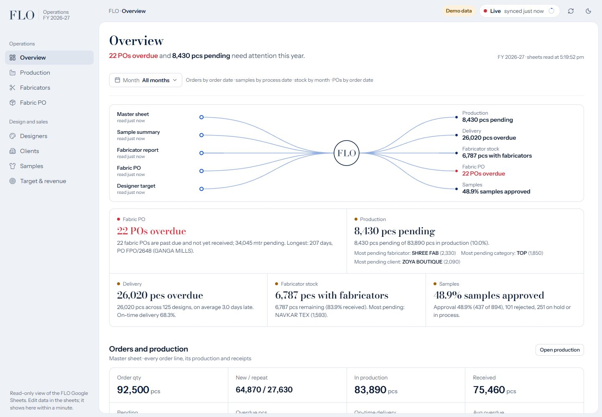
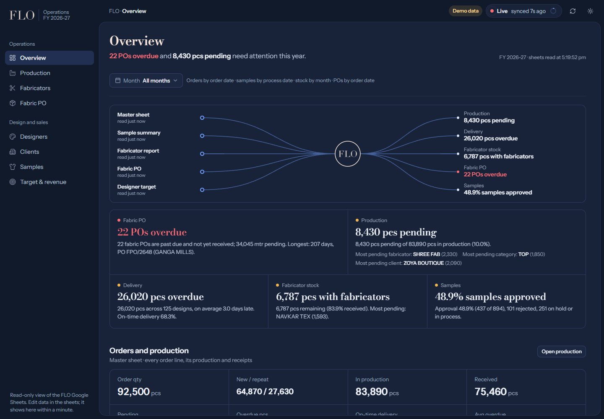
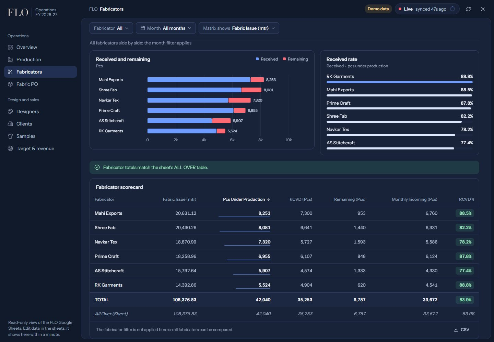
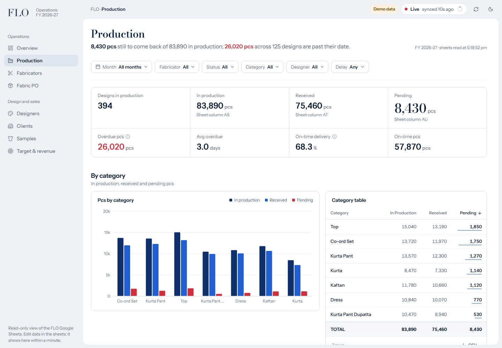
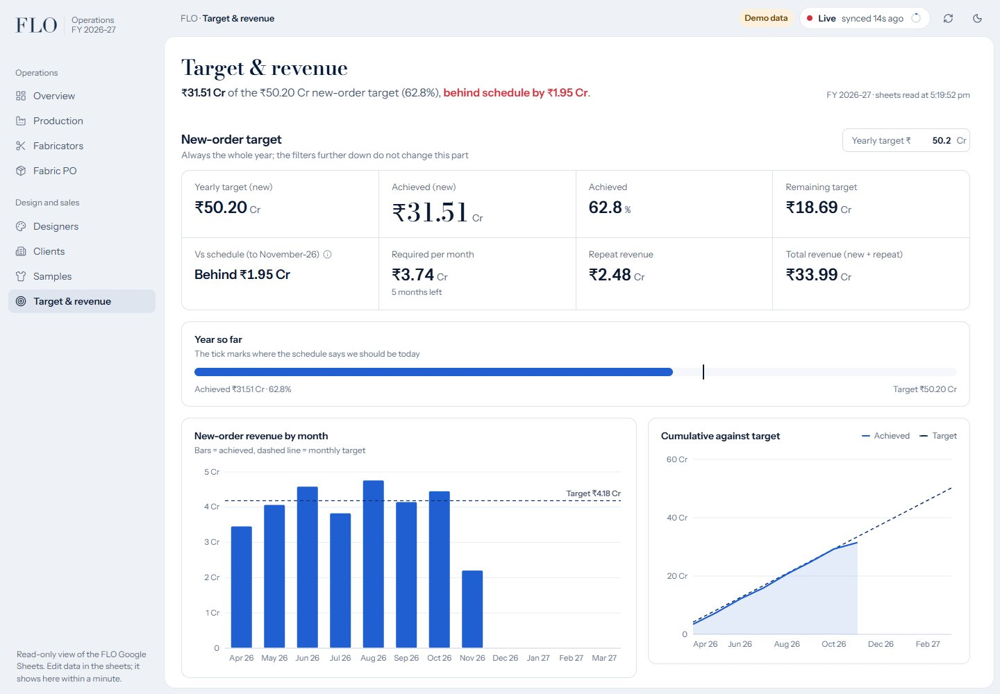
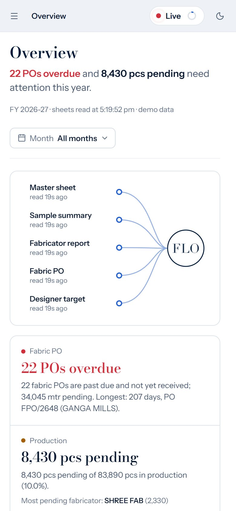
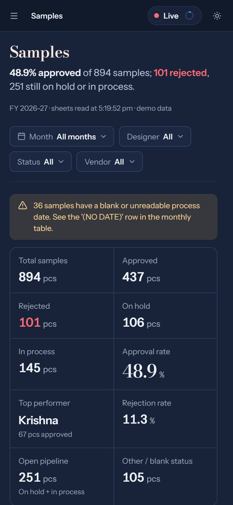
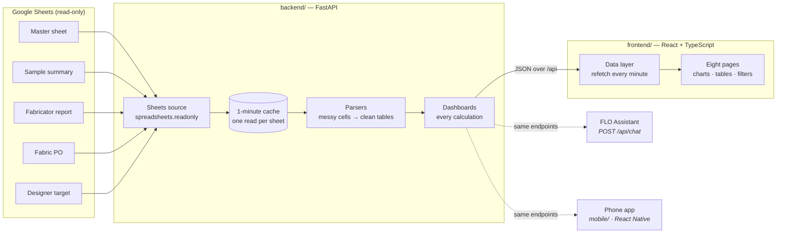

<div align="center">

<picture>
  <source media="(prefers-color-scheme: dark)" srcset="frontend/public/brand/flo-wordmark-blush.png">
  
</picture>

# FLO Operations Dashboard

**Live production, orders, samples, fabric and revenue for FLO — read straight from Google Sheets, refreshed every minute, on any phone or PC.**


[Screens](#screens) · [Dashboards](#the-eight-dashboards) · [Architecture](#how-it-works) · [Quick start](#quick-start) · [Configuration](#configuration) · [API](#api-reference) · [Testing](#testing) · [Deploy](#deploy-to-vercel) · [Phone app](#phone-app) · [Design](#design-system) · [Roadmap](#roadmap)

</div>

---

> [!NOTE]
> **Picking this up to deploy it or to build the phone app?** Start with [`CHECKPOINT.md`](CHECKPOINT.md): current
> status, a step-by-step deploy checklist and the phone-app hand-over. Short versions are in
> [Deploy to Vercel](#deploy-to-vercel) and [Phone app](#phone-app) below.

## Why this exists

FLO's operations live in five Google Sheets: the order tracker, the sample summary, the fabricator report, the fabric
purchase orders and the designers' revenue target. The team used to read them through a Streamlit dashboard. This
project replaces it with:

- a **read-only Python API** that does every calculation in one place and serves clean JSON, and
- a **fast, responsive web app** that management can open on a phone or a PC.

Every number is **proven identical to the original dashboard**: the original Streamlit app is kept in `legacy/` and
the test suite runs it side by side with the new API on the same sheet data, comparing every table cell and every KPI.

> [!NOTE]
> The screenshots below use the built-in **demo data**. All names and figures in them are invented.

## Screens

<table>
  <tr>
    <td colspan="2"></td>
  </tr>
  <tr>
    <td colspan="2" align="center"><sub><b>Overview</b> — the five sheets wired into FLO, and what needs attention right now</sub></td>
  </tr>
  <tr>
    <td width="50%"></td>
    <td width="50%"></td>
  </tr>
  <tr>
    <td align="center"><sub>Dark mode, in the logo's navy and blush</sub></td>
    <td align="center"><sub>Fabricator scorecard, cross-checked against the sheet's own totals</sub></td>
  </tr>
  <tr>
    <td width="50%"></td>
    <td width="50%"></td>
  </tr>
  <tr>
    <td align="center"><sub>Production — pending and overdue at a glance</sub></td>
    <td align="center"><sub>Target &amp; revenue — the year against the ₹50.2 Cr goal</sub></td>
  </tr>
</table>

<table>
  <tr>
    <td width="33%"></td>
    <td width="33%"></td>
    <td width="33%" valign="middle"><br><sub><b>The intro.</b> The logo's bracket draws itself like a wire, the five sheets light up as they really load, then the bracket stretches into the app's frame.</sub></td>
  </tr>
</table>

## Highlights

| | |
|---|---|
| **Live** | Each sheet is read at most once a minute; the page checks every minute and changed numbers animate to their new value. A "Live · synced 12s ago" light shows freshness. |
| **Read-only by design** | The service account uses the `spreadsheets.readonly` scope. The dashboard can never change a sheet. |
| **Exactly the old numbers** | All calculations were ported line for line and are tested against the original Streamlit app — on demo data in CI, and on the real sheets on demand. |
| **Resilient** | If Google stops answering, the last good copy stays on screen and the light turns from *Live* to *Delayed*. One failing sheet never blanks the others. |
| **Fast for everyone** | One Google read per sheet per minute no matter how many people are watching; parsed results are cached by data version. |
| **Shareable views** | Every filter lives in the page address — bookmark it, send it on WhatsApp, press Back. |
| **Phone and PC** | A real phone layout with its own navigation, not a shrunken desktop. On a PC the sidebar folds into an icon rail (button in the top bar, or press <kbd>[</kbd>) for a full-width view. Light and dark mode follow the device. |
| **Private** | Optional team passcode; signed tokens; no data reaches the browser before sign-in. |
| **Export** | Every table downloads as a CSV that opens cleanly in Excel. |
| **Ready for AI** | The same endpoints are designed to be the tools of an AI assistant ([`docs/CHATBOT.md`](docs/CHATBOT.md)). |

## The eight dashboards

| Page | The question it answers | Source sheet |
|---|---|---|
| **Overview** | What needs attention right now, across everything? | All four operational sheets |
| **Production** | How much is still to come back, who has it, and what is late? | Master sheet · `ORDER SHEET` |
| **Fabricators** | How much stock sits with each fabricator, month by month? | Fabricator report · `MONTHWISE SUMMARY` |
| **Fabric PO** | Which fabric orders are overdue, and which vendors deliver on time? | Fabric PO · `INDEX` |
| **Designers** | Who designs the most volume, new vs repeat, in which categories? | Master sheet |
| **Clients** | How much did clients order and how much has been fulfilled? | Master sheet |
| **Samples** | How many samples are approved, and per designer and vendor? | Sample summary · `2026-27` |
| **Target & revenue** | Are we on track for the yearly new-order target? Which designs sell again? | Designer target · `NEW` + `REPEAT` |

<details>
<summary><b>Business rules the dashboards apply</b> (same as the original)</summary>

<br>

- **Financial year** runs April 2026 – March 2027 (`FY_START_YEAR` in `backend/app/core.py`).
- **Overdue (production)**: an in-production design whose *delay days* (sheet column AH) is above 0. On-time % =
  designs in production with delay ≤ 0 ÷ all designs in production.
- **Fabric PO delivery**: the vendor gets 15 days from the order date (the sheet's DELIVERY DATE column; order date +
  15 when blank). Received after that date → **Delayed**; not received and past the date → **Overdue**. For part lots
  (`24/04/2026+15/05/2026`) the last date counts.
- **Revenue** = pcs × rate. The sheet's TOTAL AMOUNT column is only used for the *Data check* section.
- **Target**: the yearly target (₹50.2 Cr by default, editable on the page) applies to NEW orders only, split equally
  across 12 months (`NEW_MONTHLY_WEIGHTS` for a seasonal split). Months not yet started show no %.
- **Percentages in TOTAL rows are recomputed** from the totals, never summed or averaged.
- **Colours on rates**: approval / received / on-time — green ≥ 50%, amber ≥ 25%, red below; target achievement —
  green ≥ 100%, amber ≥ 75%, red below.

</details>

## How it works



1. **Read** — `sources/google.py` calls the Sheets API v4 with unformatted values (numbers stay numbers, dates arrive
   as serial numbers), retrying on rate limits and outages.
2. **Cache** — `store.py` keeps each tab for `LIVE_TTL_SECONDS` (60). Concurrent requests for the same tab wait for
   one fetch instead of each calling Google. A failed read falls back to the last good copy.
3. **Parse** — `dashboards/*.py` turn grids into tables, coping with what real sheets contain: text and serial dates,
   `1,234` / `(50)` / `12%`, TOTAL rows, helper rows, case variants of names, `=IMAGE()` formulas.
4. **Calculate** — each dashboard function takes the parsed data and the filters and returns KPIs, tables (rows in
   display order, TOTAL rows pinned) and chart series.
5. **Draw** — the web app renders it. Charts are hand-built SVG; GSAP animates only real changes.

## Tech stack

| Layer | Choice | Why |
|---|---|---|
| API | **FastAPI** · Python 3.11+ | Fast, typed, auto-documented (`/api/docs`) |
| Calculations | **pandas** 2.2 | The original logic is pandas; keeping it guarantees identical numbers |
| Sheets access | **google-auth** + Sheets API v4 | Read-only scope, no write library involved |
| Web | **React 19** · **TypeScript** (strict) · **Vite** | Quick builds, small bundles, code-split pages |
| Data fetching | **TanStack Query** | Per-minute refetch, keeps old numbers on screen while filters change |
| Charts | Custom **SVG** + d3-scale / d3-shape | Full control over look, accessibility and motion |
| Motion | **GSAP** (`@gsap/react`) | Count-ups, chart growth, the intro, data-flow pulses; respects reduced motion |
| Type | **Bodoni Moda** (display) · **Instrument Sans** (UI) | A Didone that echoes the FLO logo; a clean UI face with tabular figures |
| Tests | **pytest** · **Vitest** + Testing Library · **Playwright** | Logic, components and the real app in Chrome |

## Project structure

```text
flo-dashboard/
├── backend/
│   ├── app/
│   │   ├── main.py              # FastAPI app: routes, sign-in, response envelope
│   │   ├── config.py            # settings from .env + the registry of the five sheets
│   │   ├── core.py              # shared parsing (numbers, dates, months) and ₹ formatting
│   │   ├── tables.py            # TOTAL rows, row ordering, DataFrame → JSON
│   │   ├── store.py             # cache, single-flight fetching, stale-if-error, data versions
│   │   ├── sources/
│   │   │   ├── google.py        # Google Sheets (read-only)
│   │   │   └── demo.py          # realistic demo grids laid out exactly like the real sheets
│   │   └── dashboards/          # one module per dashboard: parsing + calculations
│   │       ├── master.py        #   Designer · Client · Production
│   │       ├── samples.py  fabricator.py  fabric_po.py  target.py  overview.py
│   ├── tests/                   # parity, API, filter and parsing tests
│   ├── requirements.txt         # runtime
│   ├── requirements-dev.txt     # + tests (and Streamlit, only to run the legacy app in tests)
│   └── .env.example             # copy to .env — never commit .env
├── frontend/
│   ├── src/
│   │   ├── api/                 # typed client, response types, query hooks
│   │   ├── components/          # shell, filters, tables, charts, preloader, data flow
│   │   ├── pages/               # the eight dashboards
│   │   ├── lib/                 # formatting, URL filters, live sync state, theme, CSV
│   │   └── styles/              # tokens.css (colours, type) + app.css
│   ├── e2e/                     # Playwright tests and screenshot scripts
│   └── public/brand/            # logo artwork and app icons
├── legacy/                      # the original Streamlit app — reference for parity tests only
├── assets/brand/                # original logo files
└── docs/                        # screenshots, AI assistant notes
```

## Quick start

**Needs:** Python 3.11+ and Node.js 22+ (Windows, macOS or Linux).

<details open>
<summary><b>Windows (PowerShell)</b></summary>

```powershell
# 1 — API
cd backend
py -m venv .venv
.venv\Scripts\activate
pip install -r requirements-dev.txt
copy .env.example .env
uvicorn app.main:app --reload --port 8000

# 2 — Web app (a second terminal)
cd frontend
npm install
npm run dev
```

</details>

<details>
<summary><b>macOS / Linux</b></summary>

```bash
# 1 — API
cd backend
python3 -m venv .venv && source .venv/bin/activate
pip install -r requirements-dev.txt
cp .env.example .env
uvicorn app.main:app --reload --port 8000

# 2 — Web app (a second terminal)
cd frontend && npm install && npm run dev
```

</details>

Open **http://localhost:5173**. API docs: **http://localhost:8000/api/docs**.

With no Google key in `.env`, the API serves **demo data** and the header shows a *Demo data* badge. Demo mode needs
no credentials, so anyone can work on the interface.

> [!TIP]
> To open the dashboard on a phone on the same Wi-Fi, start Vite with `npx vite --host` and visit the
> *Network* address it prints.

## Configuration

All settings live in `backend/.env` (copy `backend/.env.example`). The file is git-ignored.

| Variable | Default | Meaning |
|---|---|---|
| `DATA_SOURCE` | `google` if a key is set, else `demo` | `google` reads the real sheets, `demo` uses built-in sample data |
| `GOOGLE_SERVICE_ACCOUNT_JSON` | — | The service-account key as one line of JSON |
| `GOOGLE_SERVICE_ACCOUNT_FILE` | — | …or a path to the key file (keep it outside the repo) |
| `LIVE_TTL_SECONDS` | `60` | How often each sheet may be re-read |
| `TAB_TTL_SECONDS` | `600` | How often the list of tabs is re-read |
| `REFRESH_COOLDOWN_SECONDS` | `15` | Minimum gap between two "read now" requests |
| `DASHBOARD_PASSCODE` | — | When set, the dashboard asks for this passcode |
| `TOKEN_SECRET` | derived from the service-account key (else `dev-only-secret`) | Signs sign-in tokens. **Set a long random value in production** |
| `TOKEN_HOURS` | `336` | How long a sign-in lasts (14 days) |
| `CORS_ORIGINS` | — | Extra browser origins allowed to call the API (comma separated) |
| `GEMINI_API_KEY` | — | Optional. Lets FLO Assistant ask a small Gemini model what a question means when its rules can't tell. The model sees the question and the dashboard's labels, never any figures |
| `GEMINI_MODEL` | `gemini-flash-lite-latest` | Gemini model used for that fallback |
| `ASSISTANT_GEMINI` | `on` | `off` turns the Gemini fallback off even when a key is set |

Sheet IDs and tab names are in [`backend/app/config.py`](backend/app/config.py) (`SHEET_REGISTRY`). Each entry lists
the data tab names to try in order, with fallbacks, exactly as the original app did.

### Connecting the real Google Sheets

1. **Google Cloud Console** → enable the **Google Sheets API** → create a **service account** → *Keys* → *Add key*
   → JSON.
2. **Share each of the five sheets** with the service account's `client_email` as **Viewer**.
3. In `backend/.env` set `DATA_SOURCE=google` and either `GOOGLE_SERVICE_ACCOUNT_FILE` or
   `GOOGLE_SERVICE_ACCOUNT_JSON`.
4. Restart the API and check `GET /api/status` — every source should report `"ok": true`, and
   `GET /api/health` should say `"source": "google"`.

> [!IMPORTANT]
> Comparing numbers with the sheets or the old Streamlit app? Make sure the header does **not** show *Demo data*.
> In demo mode every figure is sample data. On 17 Nov 2026 the old app and this API were compared on the live
> sheets and every headline figure on all eight pages matched.

> [!CAUTION]
> Never commit `.env` or a key file, and never paste a key into a chat, an issue or a commit message. If a key is
> ever exposed, create a new one in Google Cloud and delete the old one.

## Security

- **Read-only Google access** — only the `spreadsheets.readonly` scope is requested.
- **Optional passcode** — compared in constant time; 10 wrong attempts a minute triggers a pause; successful sign-in
  returns an HMAC-signed, expiring token stored on the device.
- **No caching of data by browsers or proxies** — every API response carries `Cache-Control: no-store`.
- **Safe exports** — CSV cells that could run as spreadsheet formulas are neutralised.
- **Secrets stay local** — `.env`, key files and credential-shaped filenames are git-ignored.

## API reference

Every dashboard is one `GET`. Filters are query parameters; repeat a parameter to select several values
(`?month=April-26&month=May-26`). Leaving a filter out means *all*.

| Endpoint | Filters |
|---|---|
| `GET /api/overview` | `month` |
| `GET /api/production` | `month` `fabricator` `status` `category` `designer` `risk` (`Overdue` \| `On time`) |
| `GET /api/designer` | `month` `designer` `order_type` |
| `GET /api/client` | `month` `client` `order_type` `category` |
| `GET /api/samples` | `month` `designer` `status` `vendor` |
| `GET /api/fabricator` | `fabricator` `month` `metric` |
| `GET /api/fabric-po` | `month` `vendor` `order_type` `client` `designer` `item` `status` |
| `GET /api/target` | `month` `designer` `item` `order_by` `source` `annual_target_cr` |
| `GET /api/context` | `month` — a compact summary of everything, for the AI assistant |
| `GET /api/status` | — sync state of each sheet |
| `GET /api/health` | — public; whether a passcode is required |
| `POST /api/refresh` | — read the sheets again now (rate-limited) |
| `POST /api/auth/login` | `{ "passcode": "…" }` → `{ "token": "…" }` |
| `POST /api/chat` | `{ "message": "…", "context": {…} }` → FLO Assistant's answer; send back the returned `context` for follow-up questions ([`docs/CHATBOT.md`](docs/CHATBOT.md)) |

Send `Authorization: Bearer <token>` when a passcode is set.

<details>
<summary><b>Response shape</b></summary>

```jsonc
{
  "meta": {
    "fy": "FY 2026-27",
    "source": "google",            // or "demo"
    "ttl": 60,
    "synced_at": "2026-11-16T11:34:09+00:00",
    "version": "3f2a…",           // changes only when the sheet data changes
    "stale": false                 // true = Google did not answer; last good copy shown
  },
  "options": { "month": ["April-26", "…"], "designer": ["ANAMIKA", "…"] },
  "kpis": [
    { "id": "pending", "label": "Pending", "value": 8410, "unit": "pcs", "format": "int", "tone": "alert" }
  ],
  "tables": {
    "categories": {
      "columns": [{ "key": "Category", "label": "Category", "format": "text" }, "…"],
      "rows": [["TOP", 15040, 13190, 1850], "…"],
      "meta": [{ "kind": null, "muted": false }, "…", { "kind": "total", "muted": false }],
      "key_col": "Pending",
      "sorted": true
    }
  },
  "charts": { "by_category": { "categories": ["…"], "series": [{ "name": "Pending", "values": ["…"] }] } }
}
```

</details>

## Testing

| Suite | Command | What it proves |
|---|---|---|
| **Parity** (61) | `pytest tests/test_parity.py` | Runs the original Streamlit dashboards headless and the new API on the same grids; every table cell and KPI must match, across many filter combinations |
| **Parity on real sheets** | `PARITY_SOURCE=google pytest tests/test_parity.py` | The same comparison on a frozen snapshot of the live Google Sheets |
| **Filters** (9) | `pytest tests/test_api_filters.py` | Every filter of every endpoint reaches its calculation over HTTP |
| **API** (27) | `pytest tests/test_api.py` | Routes, sign-in and rate limit, refresh cooldown, one read per minute, stale-if-error, messy-cell parsing |
| **Assistant** (31) | `pytest tests/test_assistant.py` | FLO Assistant quotes the dashboard's own figures, English + Hinglish, follow-ups, read-only, sign-in, sheet-down message, Gemini fallback |
| **Frontend unit** (19) | `npm test` | Rupee and number formatting, CSV escaping, URL filters, live-sync pulses, table behaviour, chat widget |
| **Phone app** (3) | `cd mobile && npm test` | Number formatting and API helpers (plus `npm run typecheck`, `npm run lint`, `npx expo-doctor`) |
| **Browser** (31 + device-specific) | `npx playwright test` | Every page in Chrome on desktop and phone, no console errors or failed calls, on-screen numbers equal the API, filters, sign-in, theme, intro, sidebar rail, CSV export |

```powershell
cd backend;  .venv\Scripts\python -m pytest          # 128 tests
cd frontend; npm run typecheck; npm test; npm run build
cd frontend; npx playwright test                     # starts both servers if they aren't running
```

> [!NOTE]
> On the real sheets, 6 Fabric PO parity cases currently fail **by design**: the API shows the placeholder text
> "CLIENT NAME" (PO RV 1316) and "DESIGNER NAME" (PO SVV 12) as *(BLANK)*, the old app showed them as names. No
> totals change. Fixing those two rows in the sheet makes them pass. Details in [`CHECKPOINT.md`](CHECKPOINT.md).

The parity tests are why the original app is kept in `legacy/`. Delete that folder only after the old dashboard is
retired.

## Deploy to Vercel

**Live:** https://flo-dashboardd.vercel.app (personal Vercel account).

The repo deploys as **one Vercel project** with two services (`vercel.json`): the Vite build serves the pages and
every `/api/*` request goes to the FastAPI app (Python 3.12). `.vercelignore` keeps `.env`, key files, virtual
environments, tests and `legacy/` out of the upload.

0. **Use fresh keys.** Create a new service-account key (Google Cloud → *IAM → Service accounts → Keys*) and, if
   used, a new Gemini key, and delete any key that has been shared in a chat or email.
1. Import the GitHub repo in Vercel (**Add New → Project**). Leave the root directory as the repo root; Vercel reads
   `vercel.json` and builds both services.
2. **Settings → Environment Variables** (Production and Preview):

   | Variable | Value |
   |---|---|
   | `DATA_SOURCE` | `google` |
   | `GOOGLE_SERVICE_ACCOUNT_JSON` | the whole service-account key as one line of JSON |
   | `DASHBOARD_PASSCODE` | the team passcode — **required**: without it anyone with the link sees all the data |
   | `TOKEN_SECRET` | a long random value (if left out, one is derived from the service-account key) |
   | `GEMINI_API_KEY` | optional — helps FLO Assistant with questions its rules can't place |

3. Deploy, then check:
   - the site asks for the passcode;
   - the header shows **no** *Demo data* badge;
   - `https://<project>.vercel.app/api/status` (after signing in) reports `"ok": true` for every sheet;
   - a couple of headline numbers match the sheets, and FLO Assistant answers "total PO count" with the same figure.
4. Give the phone developer the Vercel address and the passcode (never the Google key).

The first request after an idle period reads all five sheets and takes about 12–15 s; after that, data is cached
for 60 s.

The same build was checked locally with `vercel build`. No extra CORS setting is needed: the web app calls `/api` on
its own domain, and the phone app is not a browser.

## Phone app

`mobile/` is the dashboard as an Android / iPhone app (React Native, Expo SDK 58) on the same API: the eight
dashboards with month chips and filters, tables and charts made for a phone screen, FLO Assistant behind the robot
button on every screen, light and dark mode, and sign-in with the same passcode. See
[`mobile/README.md`](mobile/README.md) to run it with Expo Go or build an installable app with EAS.

**Hand-over for the mobile developer** (needs the deployed address and passcode from [Deploy to Vercel](#deploy-to-vercel)):

1. `cd mobile && npm install && npx expo start`, scan the QR code with Expo Go, sign in with the Vercel address and
   passcode, and check every tab on a **real phone** (not done yet).
2. Put the Vercel address in `mobile/eas.json` → `EXPO_PUBLIC_API_URL` for **both** the `preview` and `production`
   profiles.
3. `npx eas-cli@latest build --profile preview --platform android` gives an installable APK link; use the
   `production` profile for TestFlight / the App Store.

The app only calls the API; it never calculates figures itself. Its response types in `mobile/src/lib/types.ts` are a
copy of `frontend/src/api/types.ts`, so change both if a response changes. Open items: target editor, CSV export.

## Design system

The look is taken from the FLO logo: its navy, its blush, its Didone letters and its open bracket.

| Token | Light | Dark | Used for |
|---|---|---|---|
| Frame | `#eef1f6` | `#111a2b` | The tinted L-shaped frame around the app |
| Sheet | `#ffffff` | `#18233a` | The surface the work sits on |
| Ink / brand | `#0b1a33` / `#001938` | `#eef1f7` / `#fae8de` | Text; headings and the logo |
| Data blue | `#1f5fd1` | `#6f9dff` | The main series: received, approved, achieved |
| Navy series | `#0f2f6b` | `#dbe5fb` | The reference: ordered, in production, target |
| Attention red | `#d22f3c` | `#ff6b75` | Pending, overdue, rejected — and the *Live* light |

Principles:

- **Colour means something.** The same subject has the same colour on every chart; red only marks what needs action.
- **Motion is evidence.** Numbers animate when the data really changed; data-flow pulses travel only on real
  fetches; the intro shows the five sheets actually loading. Everything respects *reduce motion*.
- **Honest data.** Zeros print as zeros, missing values as a dash, months that have not happened are not drawn as
  zero on trend lines, and every table shows a TOTAL row recomputed from its rows.
- **One question per screen.** Each page opens with a sentence that answers it, with the figure that matters in red
  or bold.

## Roadmap

- [x] Read-only API with every calculation of the original dashboard, proven identical
- [x] Responsive web dashboard: eight views, filters, light and dark, intro, live data flow
- [x] Passcode sign-in
- [x] Connected and verified against the live Google Sheets
- [x] Vercel deployment config (web + API as one project) — deploy from the Vercel dashboard
- [x] FLO Assistant that answers from the dashboard (see [`docs/CHATBOT.md`](docs/CHATBOT.md))
- [x] React Native app for iOS and Android on the same API (`mobile/`)
- [ ] Deploy on Vercel with the real sheets and a passcode (checklist in [`CHECKPOINT.md`](CHECKPOINT.md))
- [ ] Test the phone app on a real Android phone and iPhone
- [ ] Publish the phone app (EAS build → APK / TestFlight)
- [ ] Retire the Streamlit dashboard and remove `legacy/`

## Working on this project

- **Start here**: [`CHECKPOINT.md`](CHECKPOINT.md) — current status of every part, what is verified, and the next
  steps. Update it at the end of each work session.
- **Code map**: `graphify-out/` holds a knowledge graph of the repo (code, docs and how they connect).
  Open `graphify-out/graph.html` in a browser, read `graphify-out/GRAPH_REPORT.md`, or ask it questions with
  `graphify query "how does the chatbot pick a figure?"`. Refresh it after changes with `/graphify . --update`.
- **Branches**: keep `main` deployable; work on feature branches and open a pull request.
- **Run the tests** before pushing: backend `pytest`, frontend `npm run typecheck && npm test`.
- **Changing a calculation?** Change it in `backend/app/dashboards/`. The parity tests will fail on purpose — that
  is the signal to confirm the new rule with the team, then update the test to the agreed behaviour.
- **Adding a sheet**: register it in `SHEET_REGISTRY`, add a parser and a dashboard module, add its layout to
  `sources/demo.py` so demo mode keeps working, and add an endpoint in `main.py`.
- **Screenshots** for this README come from demo data: `node frontend/e2e/readme-shots.mjs` with the demo servers
  running.

## Troubleshooting

| Symptom | Fix |
|---|---|
| Header shows *Demo data* | No key found: check `DATA_SOURCE=google` and the key variable in `backend/.env`, then restart the API |
| `Google API 403` / `404` in `/api/status` | Share that sheet with the service account's `client_email` as Viewer |
| Light shows *Delayed* | Google did not answer the last read; the last good copy is shown and it retries within a minute |
| Light shows *Offline* | The browser cannot reach the API; check that `uvicorn` is running |
| A page asks for a passcode | `DASHBOARD_PASSCODE` is set — use the team passcode |
| Numbers differ from the old Streamlit app | Check for the *Demo data* badge first: demo mode shows sample figures. With the real sheets the two match |
| A number looks wrong | Compare with the sheet; the *Data check* section on *Target & revenue* lists rows whose amounts disagree with the sheet |

---

<div align="center">
<sub>Built for <b>FLO</b> — Fashion | Lifestyle | Outfit. Private and proprietary; not licensed for reuse.</sub>
</div>
